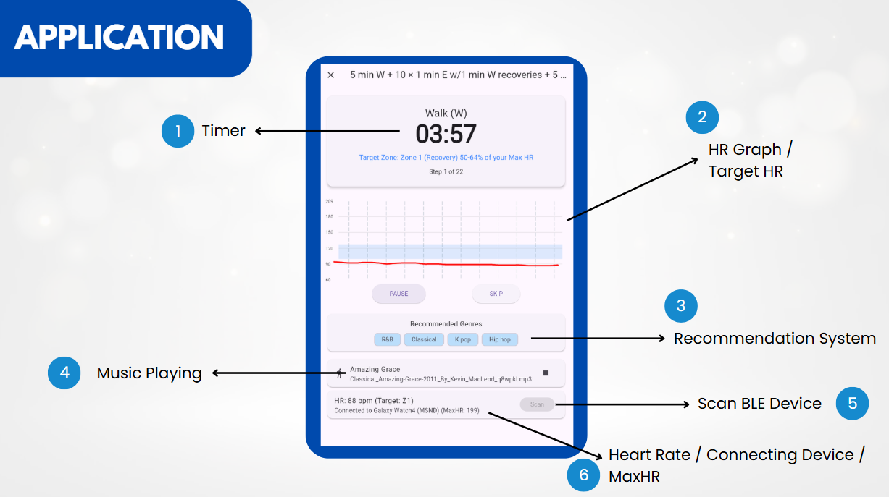
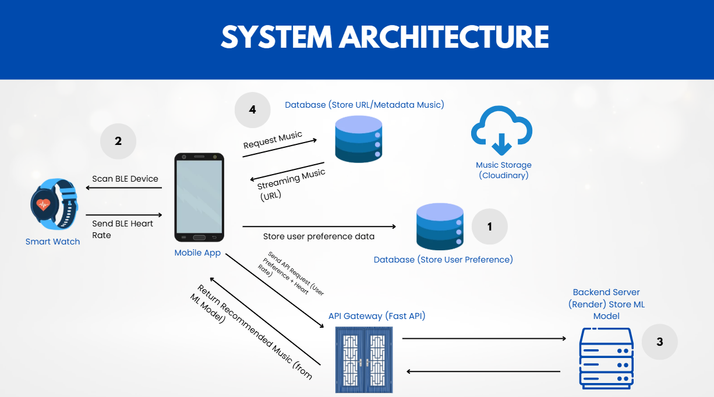
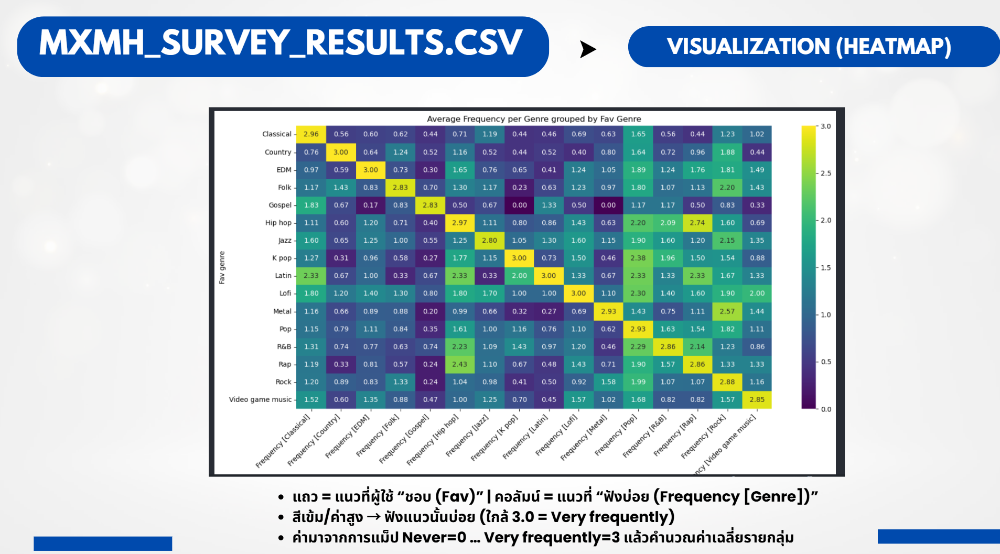
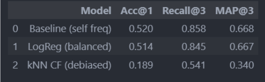
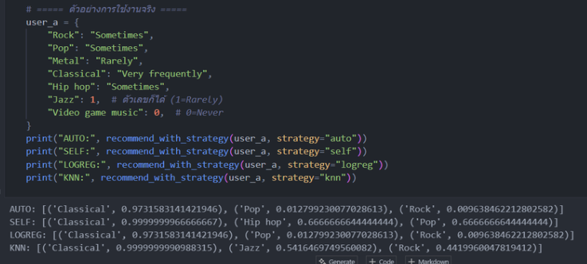
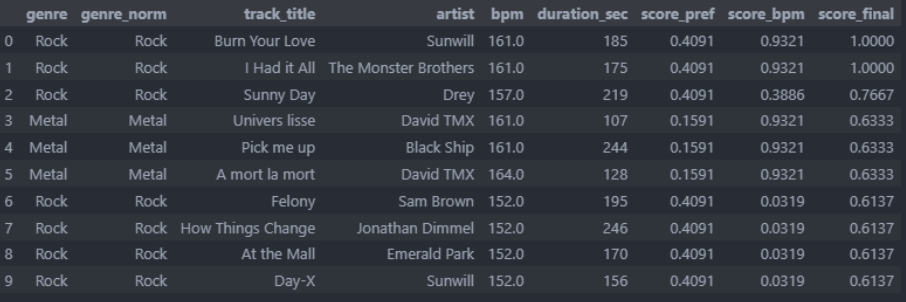
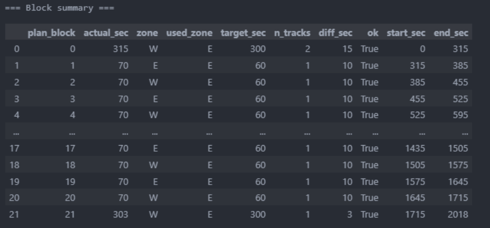

# Music Recommendation System for Running

**A research-informed music recommendation prototype combining listening preferences with predefined running intensity zones and music tempo (BPM).**

> **Project status:** Machine learning models and recommendation logic developed and evaluated in notebooks. Flutter application developed collaboratively; Model 1 was connected in a limited application demo. The full architecture below is a **proposed design**, not a fully deployed end-to-end system.

## Project Overview

This undergraduate Computer Science thesis at Naresuan University explores how to recommend music for running based on two complementary factors:

1. **Personal preference:** Recommend music genres from users' self-reported listening frequency.
2. **Workout context:** Rank tracks by how well their BPM fits the **predefined cadence targets** associated with workout intensity zones, then assemble playlists for workout blocks.

The project was completed collaboratively. **I developed the machine learning experiments, datasets, BPM matching, and playlist recommendation logic. My teammate developed the Flutter mobile application.**

## Prototype and Proposed System

The presentation includes a Flutter app demonstration with preference input, running plan selection, target heart-rate displays, and music recommendation UI. **Only Model 1 was connected in the application demo**; the full Model 1 → Model 2 → music streaming pipeline was not completed as an integrated production system.



*Flutter application screen shown in the thesis presentation (slide 12). The app was developed by my teammate; the ML/recommendation logic was my responsibility.*

### Proposed System Architecture



*Architecture proposed in the presentation (slide 13): smartwatch/BLE, Flutter app, user/music databases, API, model hosting, and music storage. FastAPI, Render, and Cloudinary in this diagram should not be interpreted as confirmed production deployments.*

### Recommendation Workflow (Model-Level Prototype)

```text
User's listening-frequency preferences (16 genres)
                   |
                   v
          Model 1: Genre ranking
                   |
             Top-3 genres
                   |
                   +-------------------------+
                                             |
Workout plan -> predefined E/M/T/I/R zones  |
        |                                    |
        v                                    v
Target cadence/SPM -> target music BPM    Genre preference score
        |                                    |
        +------------------+-----------------+
                           |
                           v
                 Model 2: Score and rank
                           |
                           v
              Workout-block playlist output
```

**Important distinction:** Heart rate (HR) is used to communicate or monitor exercise intensity targets. **The implemented BPM-matching logic is based on predefined cadence/SPM-to-BPM mappings, not direct HR-to-BPM conversion or real-time HR-driven track switching.**

## Model 1 — Music Genre Preference Recommendation

**Objective:** Recommend the most relevant music genres using listening-frequency responses.

- **Dataset:** MxMH (`mxmh_survey_results.csv`), 736 survey responses described in the presentation.
- **Input features:** Frequency responses for 16 genres, encoded `Never=0`, `Rarely=1`, `Sometimes=2`, `Very frequently=3`.
- **Target:** `Fav genre` (16 classes).
- **Experiment:** Stratified 80/20 train/test split, comparing three strategies.
- **Output:** Ranked genres / Top-3 recommendations.

### Exploratory Analysis



*Mean listening-frequency score by favorite genre (presentation slide 16). This is exploratory analysis, not a validation of recommendation accuracy.*

### Evaluation Results

| Approach | Accuracy@1 | Recall@3 | MAP@3 |
|---|---:|---:|---:|
| Self-Frequency Baseline | **0.520** | **0.858** | **0.668** |
| Logistic Regression (balanced) | 0.514 | 0.845 | 0.667 |
| kNN Collaborative Filtering | 0.189 | 0.541 | 0.340 |



*Comparison reported in the thesis presentation (slide 25). Results apply to the evaluated dataset and split; they are not user-study results.*

**Interpretation:** The simple baseline performed similarly to Logistic Regression and substantially better than the tested kNN approach. A prototype `auto` strategy was also explored: using Logistic Regression for denser user preference inputs and kNN for sparse inputs. **This strategy was exploratory; the reported evaluation does not demonstrate that kNN improves cold-start performance.**



*Example of genre ranking and the prototype automatic strategy (presentation slide 26).*

## Model 2 — BPM and Running-Zone Playlist Recommendation

**Objective:** Rank tracks that match both user genre preferences and predefined running-zone tempo targets, then assemble playlists aligned with workout blocks.

### Music Dataset

A Jamendo-based dataset was prepared through metadata collection, merging and BPM estimation. The presentation describes a target of **16 genres × 100 tracks per genre**; consult the CSV for the final number of usable records after processing and filtering.

Key fields include genre, track title, artist, BPM, duration, source, and track URL.

### Cadence-to-BPM Mapping

The model uses configurable cadence targets for five exercise zones:

| Zone | Initial cadence target (SPM) | Full-tempo BPM target | Half-tempo option |
|---|---:|---:|---|
| E — Easy | 155–170 | 155–170 | 0.5 × cadence |
| M — Moderate | 160–175 | 160–175 | 0.5 × cadence |
| T — Tempo | 165–180 | 165–180 | 0.5 × cadence |
| I — Interval | 170–185 | 170–185 | 0.5 × cadence |
| R — Repetition | 175–190 | 175–190 | 0.5 × cadence |

These are **configurable design targets**, not universal physiological prescriptions. The matching logic supports single-tempo (`1× SPM`) and half-tempo (`0.5× SPM`) matching and tolerance windows.

### Scoring and Ranking

A Gaussian BPM score favors tracks near the target tempo for a zone:

```text
score_bpm = exp(-0.5 * ((track_bpm - target_bpm) / sd)^2)
```

The recommendation combines genre preference and BPM compatibility:

```text
score_final = 0.60 * normalized_preference_score
            + 0.40 * normalized_bpm_score
```

The weights above are the defaults described in the presentation; they are configurable parameters, **not learned model coefficients**.



*BPM scoring, preference blending, and example ranking (presentation slide 29).*

### Workout-Block Playlist Generation

The notebook prototype assembles songs for planned exercise blocks while considering:

- Target duration and allowed time deviation
- BPM compatibility thresholds
- Avoiding duplicate tracks within a day
- Artist repetition limits and spacing
- Optional clip-mode for fitting block durations



*Example block-level duration and constraint checks (presentation slide 30). This demonstrates algorithmic playlist construction, not a completed end-to-end music playback integration.*

## Research-Informed Design

The design draws on literature about running step rate, music and movement synchronization, and exercise-related music. The presentation discusses, among others:

- Heiderscheit et al. (2011) — step-rate modification in running
- Karageorghis & Priest (2012) — music in exercise and sport
- Van Dyck (2015) — sensorimotor synchronization / entrainment
- Daniels' *Running Formula* — practical running cadence context

These sources motivated **configurable cadence and tempo windows**. They do not establish that the specific five zone ranges or score weights are clinically validated for all runners. Full bibliographic details and precise claims should be checked against the thesis references before publication.

## Technology Stack

**My ML work:** Python, Jupyter Notebook, Pandas, NumPy, scikit-learn, and audio/BPM processing with librosa.

**Collaborative app demo:** Flutter / Dart (developed by my teammate).

**Proposed architecture (not verified as deployed):** FastAPI, Firebase/Firestore, Render, Cloudinary, BLE smartwatch integration.

## Repository Structure

```text
thesis_model/
├── model/
│   ├── model1.ipynb
│   ├── model2.ipynb
│   ├── visualize_mxmh_dataset.ipynb
│   └── dataset/
│       ├── mxmh_survey_results.csv
│       └── jamendo_with_bpm.csv
├── thesis_jamendo_dataset/
│   ├── README.md
│   ├── fetch_jamendo_16genres_search.py
│   ├── fetch_jamendo_missing_pop_gospel.py
│   ├── merge_import_into_master.py
│   ├── estimate_bpm_from_page.py
│   └── [intermediate and final CSV datasets]
├── docs/
│   └── images/
│       └── [figures referenced in this README]
├── .gitignore
└── README.md
```

## Exploring the Notebooks

1. Clone the repository.
2. Set up a Python environment with the libraries imported by the notebooks (notably `pandas`, `numpy`, `scikit-learn`, and `librosa` for BPM processing).
3. Open `model/model1.ipynb` to explore genre recommendation experiments.
4. Open `model/model2.ipynb` to explore zone-based BPM scoring and playlist generation.
5. Open `model/visualize_mxmh_dataset.ipynb` for exploratory data analysis.

> **Reproducibility note:** A pinned `requirements.txt` and verified clean-environment run instructions have not yet been added. Some dataset-generation scripts may require Jamendo API credentials and network access. Do not commit API credentials.

## My Contribution and Collaboration

**My responsibilities:** Dataset preparation, exploratory analysis, ML model development and evaluation, recommendation strategy experiments, BPM/zone scoring, and workout-block playlist generation.

**Teammate's responsibilities:** Flutter mobile app implementation and user interface.

**Integration status:** Model 1 was demonstrated in the app; the full Model 2 / smartwatch / hosted-backend workflow remained incomplete or proposed at the time of presentation.

## Limitations and Next Steps

- The system is a research/prototype project, **not a real-time HR-adaptive recommender**.
- Model 1 results are offline evaluation metrics; there is no reported evidence here of improved running performance or motivation in a user study.
- The sparse-input kNN strategy is experimental and underperformed in the reported evaluation.
- Zone/cadence settings should be individualized and validated rather than treated as universal recommendations.
- Complete and test app/backend integration; add repeatable environment setup and broader user evaluation.

---

*This repository showcases the machine learning and recommendation-engine portion of a collaborative undergraduate thesis.*
